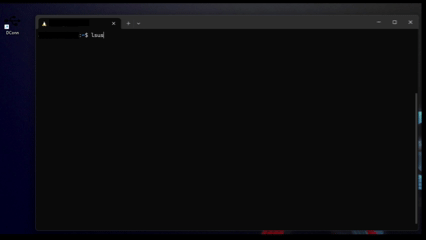

# DConn

DConn is an app for connecting USB devices to WSL.

### Requirements

- **usbipd** version 4.0.0 or later.
- **WSL (WSL 2)** with `systemd` enabled and the `vhci-hcd` kernel module loaded on boot.